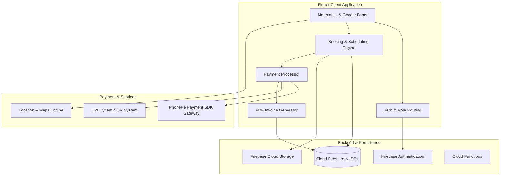
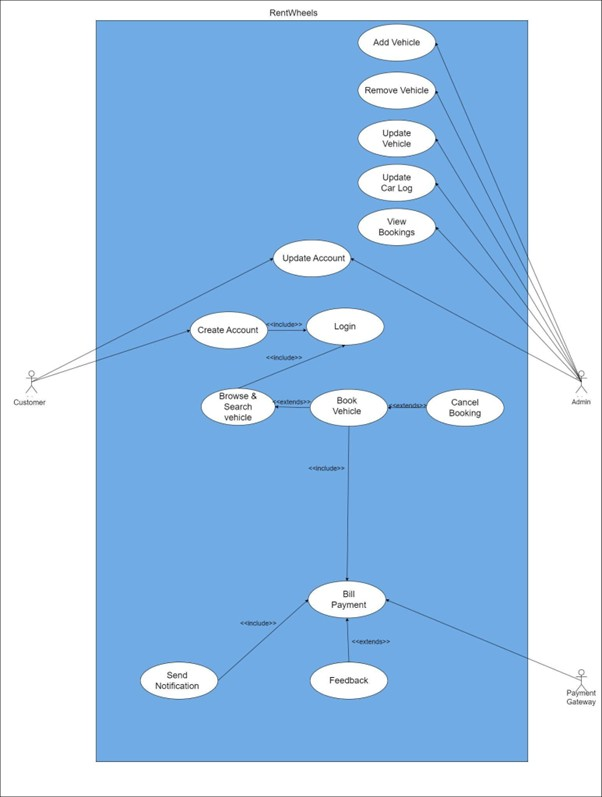
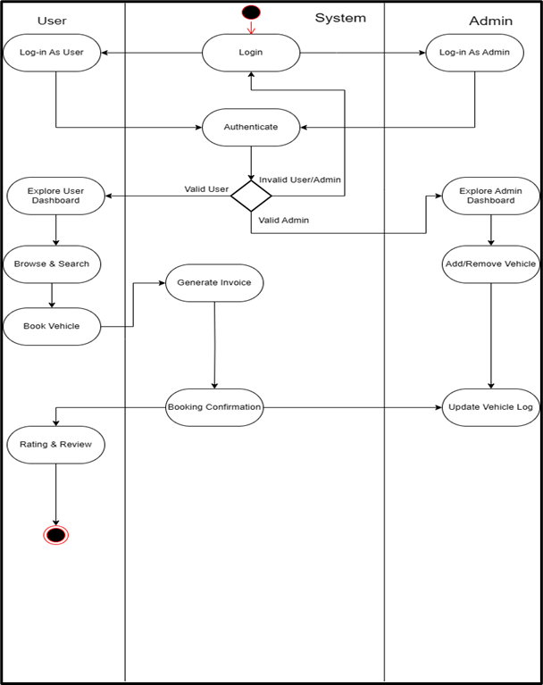

<div align="center">

  # 🚗 RentWheels
  ### Next-Generation On-Demand Car Rental & Fleet Management System

  [](https://flutter.dev/)
  [](https://dart.dev/)
  [](https://firebase.google.com/)
  [](https://developer.phonepe.com/)
  [](https://developer.android.com/)
  [](https://developer.apple.com/ios/)
  [](LICENSE)

  <p align="center">
    <b>A seamless, scalable, and cross-platform mobile solution connecting vehicle renters with fleet managers in real time.</b>
  </p>

  <p align="center">
    <a href="#-key-features">Key Features</a> •
    <a href="#-app-demonstrations--video-walkthroughs">Video Demos</a> •
    <a href="#-system-architecture--diagrams">Architecture</a> •
    <a href="#-database-schema-firestore">Database Schema</a> •
    <a href="#-technology-stack">Tech Stack</a> •
    <a href="#-getting-started">Getting Started</a> •
    <a href="#-roadmap">Roadmap</a>
  </p>

</div>

---

## 📌 Table of Contents

- [Overview](#-overview)
- [Key Features](#-key-features)
  - [Customer Portal](#-customer-portal)
  - [Admin & Fleet Management](#-admin--fleet-management)
- [App Demonstrations & Video Walkthroughs](#-app-demonstrations--video-walkthroughs)
- [System Architecture & Diagrams](#-system-architecture--diagrams)
  - [High-Level Architecture](#high-level-architecture)
  - [Use Case Diagram](#use-case-diagram)
  - [Activity Diagram](#activity-diagram)
- [Database Schema (Firestore)](#-database-schema-firestore)
- [Technology Stack](#-technology-stack)
- [Project Directory Structure](#-project-directory-structure)
- [Getting Started](#-getting-started)
  - [Prerequisites](#prerequisites)
  - [Step-by-Step Installation](#step-by-step-installation)
  - [Firebase Configuration](#firebase-configuration)
  - [Payment Gateway Setup (PhonePe & UPI)](#payment-gateway-setup-phonepe--upi)
- [Security & Best Practices](#-security--best-practices)
- [Roadmap & Future Enhancements](#-roadmap--future-enhancements)
- [Contributing](#-contributing)
- [License & Authors](#-license--authors)

---

## 📖 Overview

**RentWheels** is an enterprise-grade car rental mobile application engineered with **Flutter** and backed by **Google Firebase**. The application eliminates friction in traditional vehicle renting by offering instantaneous inventory discovery, custom rental window calculations (date & time), seamless KYC verification via driving license uploads, automated digital PDF invoice generation, and dual payment support (**PhonePe Payment SDK** and **UPI dynamic QR codes**).

The ecosystem is architected with a strict **Role-Based Access Control (RBAC)** model, partitioning user experiences into a client-facing booking application and an administrative fleet dashboard with live inventory orchestration and cancellation dispatch.

---

## ✨ Key Features

### 👤 Customer Portal

| Feature | Description |
| :--- | :--- |
| **Authentication & RBAC** | Email/Password login, Google OAuth integration, password recovery, and automatic role redirection (`client` vs `admin`). |
| **Fleet Catalog & Categorization** | Multi-category browsing (SUV, Sedan, Hatchback), Top Picks carousel, and Newly Added vehicles highlight. |
| **Dynamic Scheduling & Search** | Date-range and time-slot selector calculating exact durations and customizable doorstep vehicle delivery pricing. |
| **Vehicle Detail & Specifications** | Comprehensive car telemetry including fuel type, transmission (Manual/Automatic), seating capacity, pricing, and multi-angle photo gallery. |
| **Dual Payment Gateway** | Built-in **PhonePe SDK Sandbox** integration with SHA-256 payload checksum verification, alongside **UPI QR Code** generator with a live 60-second expiration timer. |
| **Instant PDF Invoicing** | Automatic client-side PDF receipt generation with customer metadata, order ID, and timestamp using the `pdf` engine. |
| **KYC & Profile Management** | Document upload module allowing users to upload driver licenses to Firebase Storage, modify profile details, or manage credentials. |
| **Self-Service Order Management** | Active booking view, order history, cancellation dispute requests with validation safeguards, and post-trip car review/rating submissions. |

### 🛠️ Admin & Fleet Management

| Feature | Description |
| :--- | :--- |
| **Centralized Fleet Dashboard** | Live overview of all registered vehicles, active rentals, and order status summaries. |
| **Vehicle Lifecycle Management (CRUD)** | Add new vehicles with multi-image Cloud Storage uploads, update specs/pricing, and toggle real-time availability states (`available` / `booked`). |
| **Order Supervision & Deletion** | Real-time monitoring of all global rental orders with cascaded subcollection cleanup upon order closure. |
| **Dispute & Cancellation Queue** | Dedicated notification inbox streaming client cancellation requests and detailed customer explanations in real time. |
| **Admin Profile & Privileges** | Protected administrative profile views ensuring non-admin users cannot access administrative endpoints. |

---

## 🎥 App Demonstrations & Video Walkthroughs

Experience the user and admin workflows through hands-on demonstration recordings:

| Customer Flow Walkthrough | Fleet Admin Dashboard |
| :---: | :---: |
| [](https://youtu.be/-tD_kSBihIM?si=ol-zQvNsQWm60Ob1) | [](https://youtu.be/tYeuk3_esao?si=NvKZ2MW-HCvVsCeF) |
| *Browsing catalog, picking dates, checkout, and PDF invoice generation* | *Fleet management, vehicle upload, order tracking, and cancellations* |

---

## 🏗️ System Architecture & Diagrams

### High-Level Architecture



---

### Use Case Diagram

The Use Case Diagram defines the interactions between the **Customer**, **Fleet Admin**, and the **Payment/Authentication subsystems**:

<div align="center">
  
  <br>
  <sub><i>Figure 1: Use Case Diagram mapping client reservation journeys and administrative controls.</i></sub>
</div>

> [!NOTE]
> If viewing outside a cloned repository, the diagram can also be viewed via [GitHub Asset Storage](https://github.com/user-attachments/assets/16cc4d71-18d3-4f14-9f9e-7af25bb1b96b).

---

### Activity Diagram

The Activity Diagram traces the end-to-end operational flow from vehicle selection, date calculation, payment processing, to invoice dispatch:

<div align="center">
  
  <br>
  <sub><i>Figure 2: Activity Diagram detailing the transactional lifecycle and state transitions.</i></sub>
</div>

> [!NOTE]
> If viewing outside a cloned repository, the diagram can also be viewed via [GitHub Asset Storage](https://github.com/user-attachments/assets/01bf4a67-a730-4646-9fbd-ddeb6cee6f29).

---

## 🗄️ Database Schema (Firestore)

RentWheels leverages Cloud Firestore for high-throughput, low-latency document streaming:

```
firestore-root
│
├── Users (collection)
│   └── {userEmail} (document)
│       ├── name: string
│       ├── email: string
│       ├── phone_number: string
│       ├── role1: "client" | "admin"
│       ├── imageURLs: string[] (KYC License documents)
│       └── bookings (sub-collection)
│           └── {bookingId} (document)
│               ├── orderId: string
│               ├── carId: string
│               ├── carName: string
│               ├── customerName: string
│               ├── amount: string
│               ├── startDate: string
│               ├── endDate: string
│               └── timestamp: serverTimestamp
│
├── Cars (collection)
│   └── {carId} (document)
│       ├── brand: string
│       ├── model: string
│       ├── carType: "SUV" | "Sedan" | "Hatchback"
│       ├── price: number
│       ├── fuelType: string
│       ├── transmission: string
│       ├── seats: number
│       ├── mileage: string
│       ├── registrationNumber: string
│       ├── year: string
│       ├── bookedState: "available" | "booked"
│       ├── imageURLs: string[]
│       └── reviews (sub-collection)
│           └── {reviewId}
│               ├── rating: number
│               ├── reviewText: string
│               └── userEmail: string
│
├── orders (collection)
│   └── {orderId} (document)
│       ├── bookingId: string
│       ├── carId: string
│       ├── carName: string
│       ├── customerName: string
│       ├── customerEmail: string
│       ├── phone_number: string
│       ├── amount: string
│       ├── startDate: string
│       ├── endDate: string
│       └── timestamp: serverTimestamp
│
└── cancellation (collection)
    └── {cancellationId} (document)
        ├── orderId: string
        ├── carName: string
        ├── email: string
        ├── description: string
        └── timestamp: serverTimestamp
```

---

## 💻 Technology Stack

| Category | Technology / Package | Purpose |
| :--- | :--- | :--- |
| **Mobile Core** | Flutter 3.x / Dart 3.5.4+ | Cross-platform native application runtime |
| **Authentication** | `firebase_auth`, `google_sign_in` | Credential-based & Google OAuth authentication |
| **Database & Cloud** | `cloud_firestore`, `firebase_core` | Real-time reactive data sync & NoSQL storage |
| **Object Storage** | `firebase_storage` | Vehicle image fleet & driving license storage |
| **Payments** | `phonepe_payment_sdk`, `crypto` | PhonePe payment gateway integration & SHA-256 signatures |
| **UPI Integration** | `upi_payment_qrcode_generator` | Dynamic UPI QR code generator for payment intent |
| **Document Processing** | `pdf`, `path_provider` | Programmatic PDF invoice generator and filesystem management |
| **Typography & UI** | `google_fonts`, `flutter_rating_bar` | Mulish typography & interactive star review widgets |
| **Media & Device** | `image_picker`, `permission_handler` | Multi-image camera/gallery picker and runtime OS permissions |
| **Location & Maps** | `location`, `google_maps_flutter` | Geolocation services and map integration primitives |
| **Cloud Functions** | Node.js, `firebase-functions/v2` | Serverless backend event handling and administrative tasks |

---

## 📂 Project Directory Structure

```
RentWheels--A-car-rental-app/
├── android/                   # Native Android platform bindings & Gradle scripts
├── ios/                       # Native iOS platform configurations & CocoaPods
├── assets/
│   └── images/                # Static vehicle branding assets & vendor icons
├── diagrams/                  # System UML blueprints (Use Case & Activity)
│   ├── activity.png
│   └── usecase.jpg
├── functions/                 # Firebase Cloud Functions (v2 HTTPS / Firestore triggers)
│   ├── index.js
│   └── package.json
├── lib/
│   ├── components/            # Atomic, reusable design widgets
│   │   ├── button.dart        # Custom styled primary button
│   │   ├── drawer.dart        # Navigation drawer
│   │   ├── host_button.dart   # Role switch CTA button
│   │   ├── my_textfield.dart  # Form input validation textfield
│   │   ├── square_tile.dart   # Social OAuth tile widget
│   │   └── text_box.dart      # Editable profile display tile
│   ├── services/              # Business logic, gateways & transactional screens
│   │   ├── Orders.dart        # Admin global order supervisor
│   │   ├── PhonePePayment.dart# PhonePe SDK sandbox implementation
│   │   ├── adminNotif.dart    # Admin cancellation alert monitor
│   │   ├── auth_google.dart   # Google OAuth credential handler
│   │   ├── bookingcancelled.dart
│   │   ├── bookingconfirmed.dart # PDF invoice generator & DB commit
│   │   ├── bookings.dart      # Client active bookings screen
│   │   ├── cancellation.dart  # Client dispute request form
│   │   ├── detail_screen.dart # Checkout summary view
│   │   ├── qr_code_screen.dart# Dynamic UPI QR with countdown timer
│   │   ├── review.dart        # Rating & feedback submission screen
│   │   └── searchPage.dart    # Filtered available vehicles query
│   ├── HatchbackPage.dart     # Hatchback fleet screen
│   ├── SUVPage.dart           # SUV fleet screen
│   ├── SedanPage.dart         # Sedan fleet screen
│   ├── add_vehicle.dart       # Admin vehicle creation form
│   ├── admin.dart             # Admin tabbed master dashboard
│   ├── admin_profile.dart     # Admin identity & management
│   ├── auth.dart              # Role-aware authentication root gate
│   ├── booking_gateway.dart   # Reservation calculation & method selector
│   ├── carInfopage.dart       # Comprehensive car inspection screen
│   ├── date_time.dart         # Date & time picker scheduler
│   ├── forgotpasswordpage.dart# Password reset request screen
│   ├── homepage.dart          # Client landing hub
│   ├── login.dart             # Login interface
│   ├── main.dart              # Application entrypoint & Firebase bootstrapper
│   ├── newly_added_car.dart   # Latest additions fleet page
│   ├── notification.dart      # Customer notification hub
│   ├── profile.dart           # Customer profile & KYC document viewer
│   ├── registration.dart      # Customer sign-up & KYC uploader
│   ├── showroom.dart          # Client master showroom screen
│   └── update_vehicle.dart    # Vehicle edit & specs modification
├── pubspec.yaml               # Flutter package manifest & assets registration
└── README.md                  # Project documentation
```

---

## 🚀 Getting Started

### Prerequisites

Ensure the following development tooling is installed locally:
- **Flutter SDK**: `>= 3.5.4` ([Install Flutter](https://docs.flutter.dev/get-started/install))
- **Dart SDK**: `>= 3.5.4` (bundled with Flutter)
- **Android Studio** or **VS Code** with Flutter & Dart extensions
- **Java JDK**: 11 or 17 (recommended for Gradle build toolchain)
- **Android SDK API Level 23+** (configured in `android/app/build.gradle`)
- **Firebase CLI**: `npm install -g firebase-tools`

### Step-by-Step Installation

1. **Clone the repository:**
   ```bash
   git clone https://github.com/Reiyonnaise/RentWheels--A-car-rental-app.git
   cd RentWheels--A-car-rental-app
   ```

2. **Install Flutter dependencies:**
   ```bash
   flutter pub get
   ```

3. **Verify Flutter environment health:**
   ```bash
   flutter doctor
   ```

---

### Firebase Configuration

This project requires an active Firebase project with **Authentication**, **Cloud Firestore**, and **Firebase Storage** enabled:

1. **Register your application in Firebase:**
   - Create a project on the [Firebase Console](https://console.firebase.google.com/).
   - Add an **Android Application** with Package Name:
     ```
     com.example.rentwheels.rentwheels
     ```
   - Download the generated `google-services.json` and place it in:
     ```
     android/app/google-services.json
     ```
   - *(Optional for iOS)* Add an iOS app, download `GoogleService-Info.plist`, and place it in `ios/Runner/`.

2. **Configure Platform Options:**
   - Execute the FlutterFire CLI to auto-generate `lib/firebase_options.dart`:
     ```bash
     flutterfire configure
     ```

3. **Enable Firebase Services:**
   - **Authentication**: Enable **Email/Password** and **Google Sign-In** providers.
   - **Firestore Database**: Create database in production/test mode and provision `Users`, `Cars`, `orders`, and `cancellation` collections.
   - **Storage**: Enable default Cloud Storage bucket for vehicle photos (`vehicle_images/`) and driver license documents (`user_doc/`).

---

### Payment Gateway Setup (PhonePe & UPI)

#### PhonePe Payment SDK
The integration utilizes the **PhonePe Sandbox Environment**. To configure custom or production credentials:
1. Open [`lib/services/PhonePePayment.dart`](lib/services/PhonePePayment.dart).
2. Update the environment keys:
   ```dart
   String environmentValue = "SANDBOX"; // Change to "PRODUCTION" when live
   String appId = "<YOUR_APP_ID>";
   String merchantId = "<YOUR_MERCHANT_ID>"; // Default sandbox: "PGTESTPAYUAT86"
   String saltKey = "<YOUR_SALT_KEY>";
   String saltIndex = "1";
   ```
3. Set your server callback or webhook URL:
   ```dart
   String callback = "https://your-domain.com/phonepe-callback";
   ```

#### UPI QR Generator
The UPI QR generator (`lib/services/qr_code_screen.dart`) generates an interoperable UPI intent code configured with payee name, UPI VPA, and total payable amount.

---

### Running the Application

Connect an Android device or launch an emulator, then execute:

```bash
# Run in debug mode
flutter run

# Run in release mode on a connected device
flutter run --release
```

---

## 🔒 Security & Best Practices

- **Role Guarding**: Client users cannot alter their own `role1` value; role escalation to `admin` is managed through administrative backend processes or Firestore security rules.
- **Sensitive Key Management**: For production distributions, decouple PhonePe Salt Keys and Merchant Secrets from client source code by utilizing a Cloud Function or secure backend proxy for SHA-256 signature calculation.
- **Storage Protection Rules**: Restrict KYC driving license images in `user_doc/` so that only the authenticated document owner and admin roles have read permissions:
  ```javascript
  rules_version = '2';
  service firebase.storage {
    match /b/{bucket}/o {
      match /user_doc/{imageId} {
        allow read, write: if request.auth != null;
      }
      match /vehicle_images/{imageId} {
        allow read: if true;
        allow write: if request.auth != null;
      }
    }
  }
  ```

---

## 🗺️ Roadmap & Future Enhancements

- [ ] **Real-Time GPS Tracking**: Integrate Google Maps Polyline tracking for active car delivery and vehicle return checkpoints.
- [ ] **Push Notifications**: Firebase Cloud Messaging (FCM) alerts for instant booking approvals, payment success, and return reminders.
- [ ] **Dark Mode Support**: Adaptive Material 3 theming supporting system dark and light modes.
- [ ] **Multiple Payment Gateways**: Expand options with Razorpay, Stripe, and Apple Pay/Google Pay.
- [ ] **Automated KYC Verification**: AI-powered Optical Character Recognition (OCR) to automatically extract and validate driver license numbers.

---

## 🤝 Contributing

Contributions make the open-source community an incredible place to learn, inspire, and create. Any contributions you make are **greatly appreciated**.

1. Fork the Project (`https://github.com/Reiyonnaise/RentWheels--A-car-rental-app`)
2. Create your Feature Branch:
   ```bash
   git checkout -b feature/AmazingFeature
   ```
3. Commit your Changes:
   ```bash
   git commit -m "feat: Add AmazingFeature"
   ```
4. Push to the Branch:
   ```bash
   git push origin feature/AmazingFeature
   ```
5. Open a **Pull Request**.

---

## 📄 License & Authors

Distributed under the **MIT License**. See [`LICENSE`](LICENSE) for complete details.

### Author
- **Shidharth Laishram** — Lead Developer & Architect
  - GitHub: [@Reiyonnaise](https://github.com/Reiyonnaise)

---

<div align="center">
  <sub>Built with ❤️ using Flutter & Firebase. If you found this project helpful, don't forget to star ⭐ the repository!</sub>
</div>
